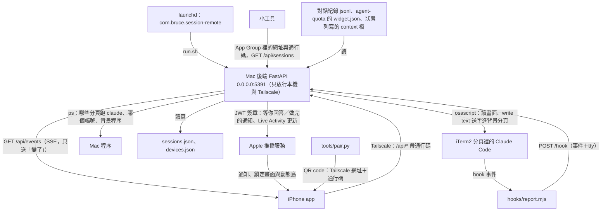
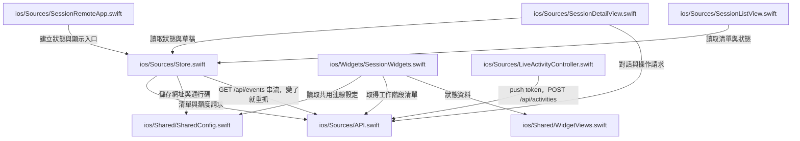
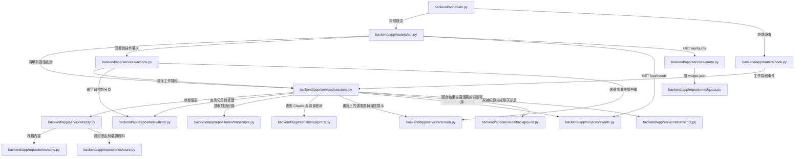

# session-remote

用 iPhone 查看和操作 Mac 上 iTerm2 裡的 Claude Code 工作階段。

## 最近更新
<!-- readme:recent 自動產生，不要手改 -->
- [2026-11-18](docs/worklog/2026-11-18.md)：改善手機送出訊息的體驗：按下就清空輸入框、收起鍵盤並顯示「送出中」，失敗時會還原文字；動態島與鎖定畫面只在有工作階段等待回答時顯示，沒人等待就立即消失
- [2026-11-17](docs/worklog/2026-11-17.md)：重寫專案說明與架構文件，並更新近期變更紀錄；整理公開測試版的功能與限制，包括查看工作階段、回覆問題、遠端控制和手機小工具
- [2026-11-16](docs/worklog/2026-11-16.md)：完成 Mac 端安裝流程，讓其他使用者能設定後端、啟動服務並用 QR code 配對；修正重新安裝、特殊路徑與設定檔造成的安裝問題，讓安裝和更新更可靠
- [2026-11-15](docs/worklog/2026-11-15.md)：docs(readme): 更新最近更新
- [2026-11-13](docs/worklog/2026-11-13.md)：docs(readme): 改版（舊版搬到 docs/）
- [2026-11-08](docs/worklog/2026-11-08.md)：手機 app 將「背景跑」與「完工」分開，列表會顯示背景正在執行的工作；等待使用者回答時若仍有背景工作，列表會顯示背景工作數量
- [2026-10-31](docs/worklog/2026-10-31.md)：/notify 可以按 thread 靜音（設定 mute_threads） (#26)
<!-- /readme:recent -->

## 這是什麼
<!-- readme:about 2026-11-17 -->
session-remote 讓你用 iPhone 查看和操作 Mac 上 iTerm2 裡的 Claude Code 工作階段。

它適合離開電腦時仍想掌握工作進度的人：手機可以合併查看兩個帳號的工作階段、閱讀對話、回答問題、處理權限提示、輸入文字、中斷工作或開啟新對話。

App 也能顯示背景工作、使用額度與 context 使用比例，並透過小工具、鎖定畫面和動態島呈現狀態。設定推播後，等待回覆或工作完成時可收到通知；尚未配對時也能使用展示模式體驗介面。

Mac 服務與手機 app 已上線，主要操作流程已在 iPhone 上驗證；TestFlight 公開發布仍在準備中。只有 iTerm2 裡的工作階段會出現在清單，Mac 必須保持喚醒並開啟 Tailscale。另有一項待查疑慮：送出文字時，若其他分頁剛好關閉，文字可能送到錯誤分頁。
<!-- /readme:about -->

## 架構
<!-- readme:arch 2026-11-16 -->
iPhone 上的 SwiftUI app 顯示清單、對話和操作畫面，透過 API 與 Mac 上的 FastAPI 服務溝通。小工具使用 app 共用的連線設定，自行向服務讀取清單；鎖定畫面與動態島的即時狀態則可透過推播更新。

Mac 端的路由接收請求，服務層處理工作階段、操作和通知，資料存取層負責讀取本機檔案、查詢程序、控制 iTerm2 和傳送推播。Claude Code 的 hook（`hooks/report.mjs`）把事件連同 tty 原封不動 POST 到本機的 /hook，狀態機在後端；對話內容從本機紀錄讀取。專案沒有資料庫或網頁前端，狀態存在 sessions.json 與 devices.json。

服務由 launchd 常駐（`launchd/com.bruce.session-remote.plist` 跑 `run.sh`），uvicorn 綁 0.0.0.0:5391，但 middleware 只放行本機與 Tailscale 位址；/api 底下每支都要通行碼，/hook 與 /notify（給 office 等本機服務推訊息）只收本機。手機用 `tools/pair.py` 印的 QR code 配對，填好 Tailscale 網址與通行碼。手機不輪詢：盯著 /api/events 的 SSE，後端只送「有東西變了」，手機再重抓 /api/sessions。送字用 iTerm2 的 write text，能送進背景分頁、不搶畫面；選項題與權限提示從分頁畫面解析出來。額度讀 agent-quota 選單列 app 寫的 widget.json，context 用量讀 claude-skills 狀態列寫的檔案，都不連網。



### 手機介面



### Mac 後端



| 資料夾 | 放什麼 |
|---|---|
| `backend/app` | 後端入口、設定、路由、服務與資料存取程式 |
| `backend/tests` | 後端測試、畫面範例與介面測試資料 |
| `docs` | 規格、筆記與舊版說明 |
| `docs/worklog` | 按日期記錄的工作日誌 |
| `hooks` | Claude Code 狀態回報程式 |
| `ios/Sources` | iPhone app 畫面、狀態與 API 程式 |
| `ios/Shared` | app 與小工具共用的設定和畫面 |
| `ios/Widgets` | 小工具與即時狀態 |
| `ios/Resources` | app 圖示等資源 |
| `ios/UITests` | iPhone app 介面測試 |
| `launchd` | Mac 常駐服務設定 |
| `tools` | 安裝、配對、測試與其他工具 |
<!-- /readme:arch -->

## 自己裝來用（不用 Apple 開發者帳號）

需要：一台 Mac，裝好 [iTerm2](https://iterm2.com)、[Tailscale](https://tailscale.com)、node、Python 3.10 以上，
在 iTerm2 裡跑 Claude Code；iPhone 也裝 Tailscale、登入同一個帳號。

1. iPhone 從 TestFlight 公開連結裝 Sessions（連結上線後補在這裡）。
2. Mac 上：

   ```bash
   git clone https://github.com/bruuucechang/session-remote.git
   cd session-remote
   tools/install.sh --dry-run   # 先看會做什麼
   tools/install.sh             # 實際安裝，最後印出配對 QR code
   ```

   它會建 Python 環境、產通行碼寫進 `.env`、把 hook 加進 `~/.claude/settings.json`（先備份）、
   裝成開機自動啟動的服務（log 在 `~/Library/Logs/session-remote.log`）。重跑安全。
3. 用 iPhone 相機掃 QR code。已經開著的 Claude Code 要重開才會被看到；第一次從手機操作時 Mac 會問要不要讓它控制 iTerm，按允許。

限制：沒有推播（等你回答、做完的通知、鎖定畫面與動態島要作者的推播金鑰）；只認 iTerm2 裡的 Claude Code；
預設只認 `~/.claude` 一個設定目錄；Mac 要保持喚醒。

## 怎麼跑
<!-- readme:run 2026-11-17 -->
需要一台安裝 iTerm2、Tailscale、Node.js 和 Python 3.10 以上版本的 Mac，並在 iTerm2 中執行 Claude Code。iPhone 也需要安裝 Tailscale，並登入同一個帳號。

公開安裝流程可先預覽變更，再安裝後端、設定常駐服務並產生配對 QR code：

```bash
git clone https://github.com/bruuucechang/session-remote.git
cd session-remote
tools/install.sh --dry-run
tools/install.sh
```

安裝後用 iPhone 相機掃描 QR code。已開啟的 Claude Code 必須重新啟動才會被看到；首次從手機操作時，請允許 macOS 控制 iTerm2。公開安裝流程的推播功能需要另行設定推播金鑰。

開發環境可在專案根目錄執行：

```bash
# 安裝並啟動 Mac 常駐服務
tools/install-agent.sh

# 編譯並安裝 iPhone app
tools/install-ios.sh

# 顯示配對 QR code
backend/.venv/bin/python tools/pair.py
```

若要直接執行後端，先停止常駐服務：

```bash
launchctl bootout gui/$(id -u)/com.bruce.session-remote
./run.sh
```

測試與狀態檢查：

```bash
# 後端單元測試
cd backend && .venv/bin/pytest
```

以下指令在專案根目錄執行：

```bash
# 介面測試，預設使用已解鎖的 iPhone
tools/uitest.sh

# 使用模擬器進行介面測試
tools/uitest.sh --sim

# 查看服務狀態
curl -s localhost:5391/health
```
<!-- /readme:run -->

## 工作日誌
每天做了什麼在 [`docs/worklog/`](docs/worklog/)，一天一份，檔名就是日期。
舊版 README：[`docs/README-舊版.md`](docs/README-舊版.md)

<!-- 標記外面的內容不會被自動覆寫 -->
