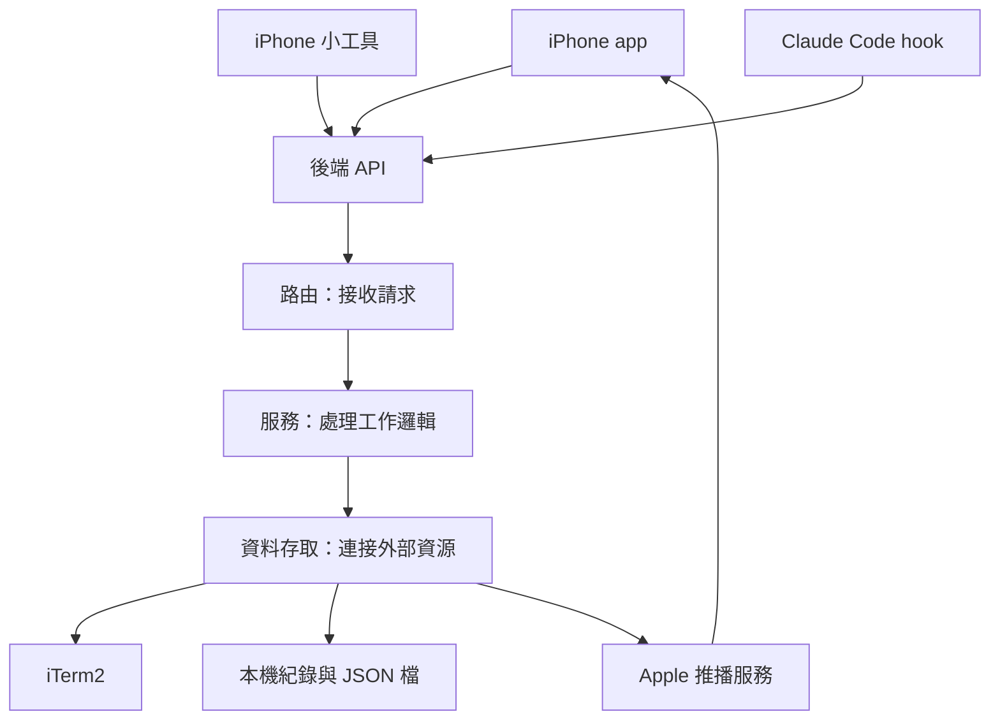

# session-remote

用 iPhone 查看和操作 Mac 上 iTerm2 裡的 Claude Code 工作階段。

## 最近更新
<!-- readme:recent 自動產生，不要手改 -->
- [2026-11-15](docs/worklog/2026-11-15.md)：docs(readme): 更新最近更新
- [2026-11-13](docs/worklog/2026-11-13.md)：docs(readme): 改版（舊版搬到 docs/）
- [2026-11-08](docs/worklog/2026-11-08.md)：手機 app 將「背景跑」與「完工」分開，列表會顯示背景正在執行的工作；等待使用者回答時若仍有背景工作，列表會顯示背景工作數量
- [2026-10-31](docs/worklog/2026-10-31.md)：/notify 可以按 thread 靜音（設定 mute_threads） (#26)
- [2026-10-26](docs/worklog/2026-10-26.md)：完成手機 app 大整理，並在 iPhone 上驗證開啟工作、回答問題、處理權限、中斷及關閉分頁等流程；修正送出文字後鍵盤擋住下一題選項的問題
- [2026-10-25](docs/worklog/2026-10-25.md)：修正手機開新 session 的流程：先選資料夾，再按「開始」，捲動清單也會收起鍵盤；整理列表、設定與配對畫面，讓連線失敗、空列表和搜尋無結果時都有清楚提示；設定也會先確認能連線才儲存
- [2026-10-22](docs/worklog/2026-10-22.md)：手機回答多題問卷後，會顯示答案摘要和送出確認按鈕；修好多題問卷中複選題無法進入下一題的問題，也讓自填答案可以修改並正確送出
<!-- /readme:recent -->

## 這是什麼
<!-- readme:about 2026-11-13 -->
session-remote 把兩個帳號的工作階段合併到手機清單，方便離開電腦時查看對話、回答問題、處理權限提示、輸入文字、中斷工作或開啟新對話。

手機 app 也能顯示背景工作、使用額度與 context 使用比例，並透過小工具、鎖定畫面和動態島呈現狀態。設定推播後，工作階段等待回覆或完成時可收到通知。

目前服務與手機 app 已上線，主要操作流程已在 iPhone 上驗證。只有 iTerm2 裡的工作階段會出現在清單；Mac 必須保持喚醒，並開啟 Tailscale，手機才能連線。曾記錄一項待查疑慮：送出文字時若其他分頁剛好關閉，文字可能送到錯誤分頁。
<!-- /readme:about -->

## 架構
<!-- readme:arch 2026-11-13 -->
iPhone 上的 SwiftUI app 負責呈現清單、對話和操作畫面，透過 API 與 Mac 上的 FastAPI 服務溝通。小工具也會向服務取得資料。

後端分成三層：路由接收請求，服務處理工作階段等邏輯，資料存取層則負責與 iTerm2、程序、紀錄檔和推播服務等外部資源互動。Claude Code 的 hook 會把狀態回報給後端；對話內容則從本機紀錄讀取。專案沒有資料庫，也沒有網頁前端。



| 資料夾 | 放什麼 |
|---|---|
| `backend/app/routers` | 接收 API 與 hook 請求的路由 |
| `backend/app/services` | 工作階段、通知、畫面與其他業務邏輯 |
| `backend/app/repositories` | iTerm2、程序、本機檔案與推播等外部資源的存取 |
| `backend/tests` | 後端測試及測試資料 |
| `ios/Sources` | iPhone app 的畫面、狀態與 API 程式 |
| `ios/Shared`、`ios/Widgets` | 共用設定、畫面與小工具 |
| `ios/UITests` | iPhone app 介面測試 |
| `hooks` | Claude Code 狀態回報程式 |
| `launchd` | Mac 常駐服務設定 |
| `tools` | 安裝、配對、測試與其他工具 |
| `docs` | 規格、筆記與工作日誌 |
<!-- /readme:arch -->

## 怎麼跑
<!-- readme:run 2026-11-13 -->
第一次使用時，先允許 macOS 控制 iTerm2，並將 iPhone 解鎖、接上同一個 Wi-Fi 或用線連接 Mac。

```bash
# 安裝並啟動 Mac 常駐服務
tools/install-agent.sh

# 編譯並安裝 iPhone app
tools/install-ios.sh

# 顯示配對 QR code，用 iPhone 相機掃描
backend/.venv/bin/python tools/pair.py
```

開發時若要直接執行，先停掉常駐服務：

```bash
launchctl bootout gui/$(id -u)/com.bruce.session-remote
./run.sh
```

測試與狀態檢查：

```bash
# 後端單元測試
cd backend && .venv/bin/pytest

# 介面測試：預設使用已解鎖的 iPhone
tools/uitest.sh

# 使用模擬器進行介面測試
tools/uitest.sh --sim

# 查看服務狀態
curl -s localhost:5391/health
```

以上指令除標明進入 `backend` 的測試指令外，皆在專案根目錄執行。
<!-- /readme:run -->

## 工作日誌
每天做了什麼在 [`docs/worklog/`](docs/worklog/)，一天一份，檔名就是日期。
舊版 README：[`docs/README-舊版.md`](docs/README-舊版.md)

<!-- 標記外面的內容不會被自動覆寫 -->
